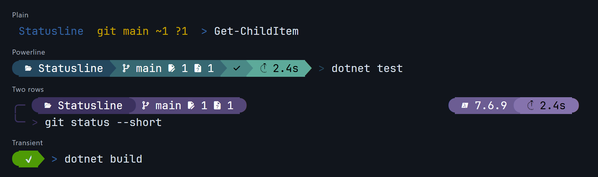
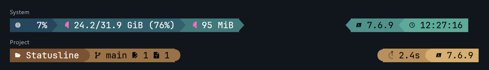

# StatusLine

PowerShell prompts and a live terminal status line built from the same reusable blocks.
Display project context, command results, and system activity in either surface.

## Features

- **Prompt layouts** — one or two rows, left and right groups, and compact transient prompts.
- **Status line** — a separate row of system activity and other blocks on supported terminals.
- **Appearance** — gradients, Powerline or rounded segments, and Nerd Font, Unicode, or plain text icons.
- **Reusable blocks** — built-in blocks and custom PowerShell script blocks for both surfaces.
- **Background updates** — slow blocks retain their last result; updates pause after a minute of inactivity.
- **Shell integration** — prompt and command markers, exit status, and working-directory reporting
  for supported terminals, with optional terminal progress.

Importing StatusLine leaves your prompt alone. Enable the features you want, when you want them.

## Previews

### Prompt



### Statusline



Run [Show-Examples.ps1](tools/Show-Examples.ps1) to preview these layouts in one terminal.
These images capture the preview commands' rendered output; command text, exit codes, and durations are examples.
Rows labelled "sample" use fixed session counts, weather, uptime, CPU, and RAM values.

## Install

```
Install-Module Statusline
```

## Commands

| Command | Purpose |
| --- | --- |
| [Enable-StatusLine](docs/en-US/Enable-StatusLine.md) | Start or reconfigure the live status line |
| [Disable-StatusLine](docs/en-US/Disable-StatusLine.md) | Stop status-line updates |
| [Enable-Prompt](docs/en-US/Enable-Prompt.md) | Install or reconfigure your prompt |
| [Disable-Prompt](docs/en-US/Disable-Prompt.md) | Restore your previous prompt |
| [New-StatusLineBlock](docs/en-US/New-StatusLineBlock.md) | Create a reusable block for either surface |
| [Show-Prompt](docs/en-US/Show-Prompt.md) / [Show-StatusLine](docs/en-US/Show-StatusLine.md) | Preview settings without enabling them |
| [Measure-Codepoint](docs/en-US/Measure-Codepoint.md) | Inspect Unicode width and grapheme measurements |


## Pick your blocks

| Show | Blocks |
| --- | --- |
| Project context | Directory, Git, Package, VirtualEnv |
| Command and session information | Status, Duration, HistoryId, Errors, StackCount, NestedPrompt, Runspaces |
| System activity | Cpu, Gpu, Network, SystemMemory, ProcessMemory, Battery |
| Runtime versions | PowerShell, Node, Python, Dotnet, Go, Rust, Java, Ruby |
| Environment and services | User, Host, Os, Elevation, Aws, Azure, Kubernetes, Docker |
| Time and weather | Clock, Date, Uptime, Weather |

Blocks with nothing to show are omitted. See the [block reference](docs/Configuration.md#available-blocks)
for details and platform availability.

## Build

The current source targets .NET 10 and requires PowerShell 7.6 or newer.
Build from the repository root, then import the module:

```powershell
./build.ps1
Import-Module ./output/StatusLine.psd1
Enable-Prompt
```

For Nerd Font icons and segment separators, use a patched font such as Cascadia Mono NF.
Prefer a plain look? Try `Enable-Prompt -IconSet None -Style Plain`.

The default prompt shows Directory, Git, Status and Duration. The default statusline shows
Cpu, ProcessMemory and Clock, keeping the two surfaces complementary. All other blocks remain
available when selected explicitly.


## Make it yours

### A colorful Git prompt

Keep your working directory and branch on the left, with command duration and a clock on the right.
Transient mode compacts previous prompts after you press Enter.

```powershell
$promptOptions = @{
    Left       = 'Directory', 'Git', 'Errors'
    Right      = 'Duration', 'Clock'
    StartColor = '#275DAD'
    EndColor   = '#E8A33D'
    Transient  = $true
}
Enable-Prompt @promptOptions
```

To give elevated sessions their own gradient, add these optional entries to the splat:

```powershell
$promptOptions.ElevatedColorStart = '#ff7b00ff'
$promptOptions.ElevatedColorEnd   = '#cc2200'
Enable-Prompt @promptOptions
```

Supply both colors or neither. This works with or without an `Elevation` block;
unelevated sessions keep the normal `StartColor` and `EndColor`.

### Room for context

Right-hand blocks automatically get a context row above input, leaving the editing line clear.
The optional `╭─` / `╰─` markers connect the rows when `-ConnectRows` is enabled.
Add shared blocks beside the input marker with `Input`.

```powershell
$promptOptions = @{
    Left        = 'Directory', 'Git', 'VirtualEnv'
    Right       = 'Status', 'Duration'
    Input       = 'Errors', 'NestedPrompt'
    ConnectRows = $true
}
Enable-Prompt @promptOptions
```

### A live system dashboard

On a terminal with host-writable status-line support, such as Contour, keep system activity
visible separately from your prompt. The middle group stays centered as other values change.

```powershell
$statusLineOptions = @{
    Left       = 'Duration', 'Status'
    Center     = 'Weather', 'Uptime'
    Right      = 'Network', 'Cpu', 'SystemMemory', 'Clock'
    StartColor = '#244A73'
    EndColor   = '#62C4A6'
}
Enable-StatusLine @statusLineOptions
```

Weather is opt-in and requests data from wttr.in; `-WeatherLocation` chooses the location.
Duration is captured by the prompt, so enable both to show it on the statusline. The prompt can be
used independently of status-line support. Contour users should read the
[scrollback setting](docs/Configuration.md#preserve-scrollback-in-contour).

### Add your own block

Create a block, then reuse it in your prompt or statusline. Built-in blocks can have their own colors:

~~~powershell
$duration = New-StatusLineBlock -Kind Duration -Foreground White -Background '#1034A6'
$processes = New-StatusLineBlock -ScriptBlock {
    "Processes: $((Get-Process).Count)"
} -IntervalMilliseconds 5000 -Foreground '#FFAA33'

Enable-Prompt -Left @('Directory', 'Git', $processes) -Right $duration
~~~

Custom scripts refresh in the background only while selected. See [custom blocks](docs/Configuration.md#custom-refreshing-blocks)
for session information, styling and timeouts. Keep the same definition object to share its cached
script output between the prompt and statusline. No registration or unregister step is needed.


## Learn more

- [Experimental native CLI](cli/README.md) — Bash, Zsh, Fish prompt setup and [supported blocks](cli/README.md#supported-blocks), including shell name and version.
- [Configuration guide](docs/Configuration.md) — layouts, colors, directory display, idle behavior,
  terminal compatibility, and troubleshooting.
- [File output for Contour](docs/Configuration.md#file-output-and-contour-program) — an alternative
  to host-writable output.
- [Command reference](docs/en-US/StatusLine.md) and `Get-Help Enable-Prompt -Examples`.

## License

[MIT](LICENSE)
